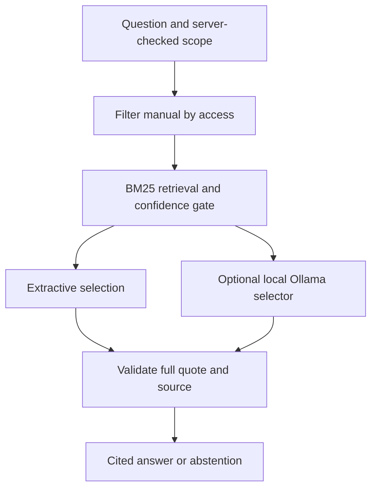

# Evaluated retrieval for a workforce product

**When should a workforce assistant answer or abstain?** A support team needs a manual-backed answer with a citation that the caller is allowed to see. This local assistant filters passages by scope, retrieves candidates and returns a verified quotation or an explicit abstention.

The extractive mode selected the expected source for 12 of 13 answerable held-out prompts and abstained on all five unanswerable or scope-restricted prompts. Its miss was a paraphrase about retracting a holiday application. The fixture has 18 hand-authored holdout cases, so this is a regression benchmark.

## Try it locally

Use Python 3.12 from the repository root. The demo generates its own synthetic inputs in a temporary directory and prints a decision readout.

```powershell
py -3.12 -m venv .venv
.\.venv\Scripts\python.exe -m pip install ".[dev]"
.\.venv\Scripts\python.exe scripts/demo.py
.\.venv\Scripts\python.exe -m unittest discover -s tests -v
```

On Linux or macOS, use `python3.12 -m venv .venv` and `.venv/bin/python` for the remaining commands. For the persistent example below, activate the environment first with `.\.venv\Scripts\Activate.ps1` in PowerShell or `source .venv/bin/activate` in Bash.

## Persistent example

```shell
knowledge-eval
python -m uvicorn workforce_knowledge.api:app --port 8080
```

With the service running, query it from PowerShell.

```powershell
$body = @{question='How can I correct a missed clock entry?'} | ConvertTo-Json
Invoke-RestMethod http://127.0.0.1:8080/v1/answer -Method Post -ContentType application/json -Body $body
```

The reference response cited `clock.correction`. For optional model selection, install and start Ollama on the same host, pull the named model, set `$env:ANSWER_MODE='ollama'` and restart this API. The shipped Compose example runs extractive mode. [Case-level evaluation](docs/holdout.json) · [Ollama API](https://docs.ollama.com/api/generate)

## Architecture and methodology



The corpus contains 16 original synthetic manual passages. A query must share at least two terms with a candidate and pass coverage and BM25 score gates. Retrieval returns at most three scoped passages. The optional model selects a source and quote. The service checks both against those precise candidates before exposing the answer. Six development prompts are separate from 18 held-out prompts. Mean reciprocal rank is 0.923 for the answerable holdout.

An in-memory lexical index over a tiny corpus keeps retrieval explainable. FastAPI provides the typed HTTP boundary. HTTPX calls the optional loopback Ollama service. Extractive mode runs offline. The model adapter passed controlled-response and outage tests. An actual model generation remains unverified.

## Verification and operations

5 automated tests passed locally. The standalone demo ran twice with matching decision outputs. The HTTP smoke test also exercised a running server on a loopback TCP port. The repository includes a GitHub Actions workflow and Docker configuration. Hosted CI and container execution are pending.

Query the service on loopback. By default callers see public content. A local operator can set SUPPORT_KEY outside the repo and send it in X-Support-Key. Invalid credentials return 403. Logs record mode, disposition and elapsed milliseconds. Optional local model mode uses ANSWER_MODE=ollama and OLLAMA_MODEL with an installed model on 127.0.0.1:11434. Provider outages lead to abstention. Revert by restarting in extractive mode.

## Limitations and next release

A correct quotation can still be irrelevant or out of date. Lexical retrieval misses paraphrases and multilingual questions. The support key is a single local credential. Customer deployment needs identity-provider roles, document version governance and evaluation with real support staff.

Author and scope the manual, calibrate on development prompts, freeze the holdout and evaluate. Next run a real local model and compare against the extractive baseline on a larger blinded multilingual set. Establish a cost-per-resolved-ticket and escalation baseline before any pilot.

[Product requirements, architecture decision and runbook](docs/design.md) · [Example output](docs/example.json) · [Executed commands and results](docs/verification.txt) · [Interview walkthrough](docs/interview.md)
